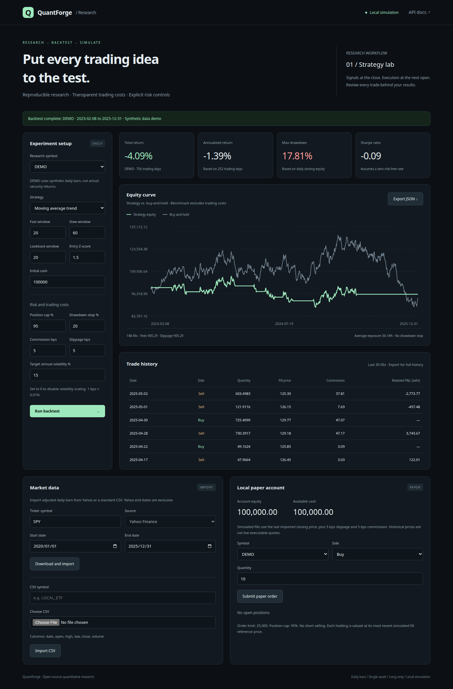

# QuantForge

A local Python platform for quantitative research: market data ingestion, strategy signals, backtesting with trading costs, risk controls, report exports, and persistent paper trading. Includes an English research dashboard and REST API. The full demo runs without API keys.

**Current scope: daily stock / ETF bars, one asset per backtest, long only, no leverage, and local simulated fills.** No live broker connection is included. DEMO uses clearly labeled synthetic data and does not represent actual security returns.



## Quick start

Requires Python 3.11+. Run from the project root:

```bash
python3 -m venv .venv
source .venv/bin/activate
# Windows PowerShell: .venv\Scripts\Activate.ps1
python -m pip install -e '.[dev]'
quantforge demo
quantforge serve
```

Open **http://127.0.0.1:8000**. Interactive API documentation is available at **http://127.0.0.1:8000/docs**. The dashboard automatically runs a demo backtest on first load.

If your package index is not configured, use `python -m pip install --index-url https://pypi.org/simple -e '.[dev]'`.

## Features

| Module | Capabilities |
| --- | --- |
| Market data | Reproducible synthetic bars, standard CSV imports, Yahoo adjusted daily bars |
| Validation | Rejects duplicate dates, missing columns, NaN, infinite values, nonpositive prices, and invalid OHLC |
| Strategies | Moving average trend, time-series momentum, stateful mean reversion |
| Backtesting | Closing signals executed at the next open, commissions, slippage, and cash constraints |
| Risk controls | Position limits, historical volatility scaling, next-open liquidation after a closing drawdown trigger |
| Performance | Returns, annualized volatility, Sharpe ratio, drawdown, sell-fill win rate, and trading costs |
| Reports | Equity and trade CSVs, plus JSON with parameters and daily records |
| Paper trading | SQLite persistence, transactional risk checks, idempotent orders, cash and cost-basis accounting |
| Dashboard | Parameter editing, equity curves, trade history, imports, exports, and paper orders |
| Engineering | Python package, CLI, automated tests, Ruff, GitHub Actions, MIT license |

## Command-line workflow

```bash
# Offline demo; includes the corresponding synthetic market data CSV
quantforge demo --output reports/demo

# Download historical data. The end date is exclusive; availability depends on Yahoo.
quantforge download SPY --start 2020-01-01 --end 2025-12-31

# Backtest the downloaded data
quantforge backtest data/datasets/SPY.csv --strategy trend --cash 100000
quantforge backtest data/datasets/SPY.csv --strategy momentum --output reports/momentum
quantforge backtest data/datasets/SPY.csv --strategy mean_reversion --output reports/reversion

# Start the dashboard on another port
quantforge serve --port 8080
```

CSV dates should use `YYYY-MM-DD`. All prices must use consistent adjustments; do not mix unadjusted OHLC with adjusted closing prices.

```csv
date,open,high,low,close,volume
2025-01-02,100,102,99,101,1000000
2025-01-03,101,104,100,103,1200000
```

There is no automatic currency conversion. Initial cash, prices, and monetary returns must use the same currency. Do not combine assets denominated in different currencies in one paper account.

## Python research interface

```python
from quantforge.data import demo_bars
from quantforge.engine import BacktestConfig, run_backtest
from quantforge.strategies import StrategyConfig

result = run_backtest(
    demo_bars(),
    StrategyConfig(name="trend", fast=20, slow=60),
    BacktestConfig(
        initial_cash=100_000,
        commission_bps=5,
        slippage_bps=5,
        max_position=0.95,
        target_volatility=0.15,
        max_drawdown=0.20,
    ),
)
print(result.metrics)
result.export("reports/custom")
```

See [Research and execution assumptions](docs/METHODOLOGY.md) for strategy parameters and fill mechanics, and [Architecture](docs/ARCHITECTURE.md) for extension points.

## Paper trading rules

Dashboard orders use the dataset's **last closing price** as their reference. Buy fills add 5 bps of slippage, sell fills subtract 5 bps, and both incur 5 bps commission. This is a local fill simulator; it does not match live orders or send orders to a broker.

- Initial cash: 100,000. Maximum order notional: 25,000. Maximum single-position allocation: 95%.
- No overdrafts, short selling, or nonpositive quantities. Fractional shares are supported.
- `client_order_id` provides idempotency: retrying an ID does not create another fill, and reusing it with different parameters is rejected.
- Account equity uses each holding's most recent simulated fill reference price. Its date is returned by the API; valuations do not refresh automatically.
- Accounts are stored in `data/paper.sqlite3` and market data in `data/datasets/`. Set `QUANTFORGE_DATA_DIR` to use another directory. `.env` files are not loaded automatically.
- Accounts persist across sessions. Use separate data directories for independent research accounts.

```bash
QUANTFORGE_DATA_DIR=./data/experiment-2 quantforge serve --port 8001
```

## API

| Method and path | Purpose |
| --- | --- |
| `GET /api/health` | Service health |
| `GET /api/datasets` | Imported symbols |
| `POST /api/data` | Import demo or Yahoo data |
| `POST /api/data/csv` | Import a CSV string |
| `POST /api/backtests` | Return parameters, equity, fills, and metrics |
| `GET /api/paper/account` | Account, positions, and the latest 100 orders |
| `POST /api/paper/orders` | Submit a local paper order |

```bash
curl http://127.0.0.1:8000/api/backtests \
  -H 'Content-Type: application/json' \
  -d '{"symbol":"DEMO","strategy":{"name":"trend","fast":20,"slow":60}}'
```

The service binds to `127.0.0.1` by default and has no user authentication. It is intended for one user on a local machine. Multiuser or public deployments require authentication, access controls, TLS, and request resource limits.

## Development and validation

```bash
ruff check .
ruff format --check .
pytest -q
python -m build
```

Tests cover signal and fill timing, future-data isolation, costs and accounting identities, drawdown liquidation, no-trade scenarios, input validation, cash and position constraints, concurrent order retries, and the API workflow from data import to paper fills. CI runs on Python 3.11, 3.12, and 3.13 and uploads demo reports as build artifacts.

`requirements.lock.txt` records exact dependencies from the validated development environment. Installing from `pyproject.toml` is sufficient for normal use. See [Validation](docs/VALIDATION.md) for verification details.

## GitHub repository

Repository: [maxtyy/quantforge](https://github.com/maxtyy/quantforge). It is public and available under the MIT License.

```bash
git clone https://github.com/maxtyy/quantforge.git
cd quantforge
```

Local account databases, credentials, and licensed market data should stay out of version control. The repository ignores `data/`, `reports/`, and `.env` files.

## Limitations

The project does not yet include multi-asset portfolio optimization, walk-forward evaluation, exchange-calendar validation, price-limit or trading-halt rules, A-share board-lot and T+1 restrictions, live broker adapters, or production operations tooling. CSV imports can represent different markets, but their execution rules need market-specific extensions. Historical backtests and synthetic demos do not establish future profitability.

MIT License. Issues and pull requests are welcome.
